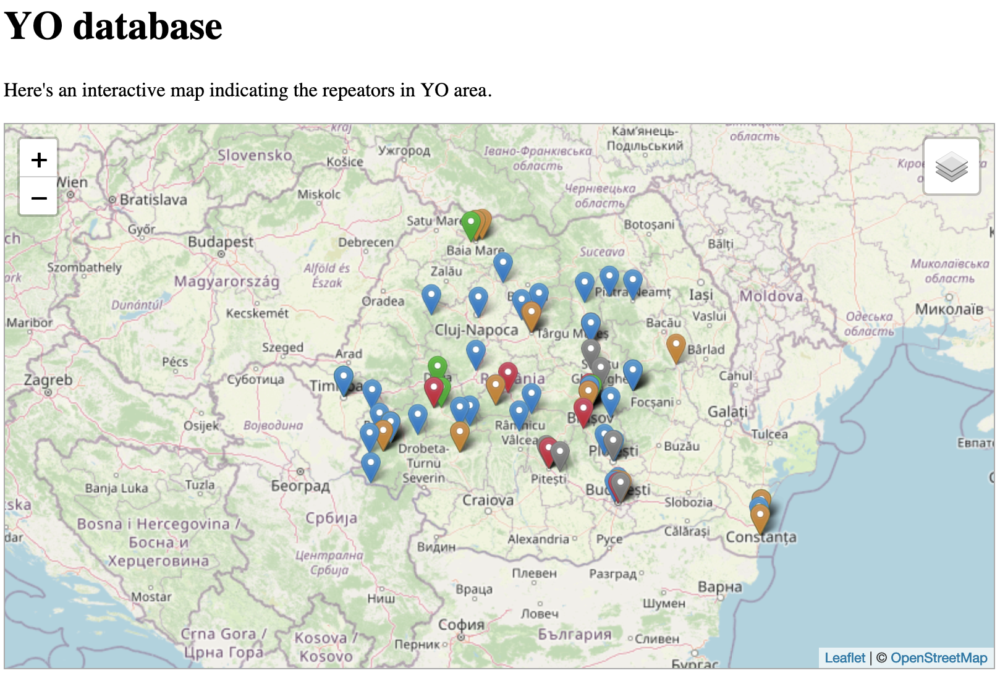

# repeaters-map
OSM interactive map with repeaters in YO area, and not only.
- osm.html - the page that makes the below picture
- all-in-one-page.html - a page meant to be deployed on websites and contains everything needed to render the map with repeaters

Started from: https://asmaloney.com/2014/01/code/creating-an-interactive-map-with-leaflet-and-openstreetmap/

## Used libraries and tools

### Stuff used:
- [leaflet](https://leafletjs.com/) 
- [icons](https://github.com/pointhi/leaflet-color-markers) 
- [YO db file](https://github.com/yo6nam/yodb) 
- [qth-locator](https://github.com/jleh/qth-locator) 
- [leaflet.markercluster](https://github.com/Leaflet/Leaflet.markercluster) 
- [reverse geocoding](https://github.com/osm-search/Nominatim) 

### DBs from internet:
From the below links i made the JSON files and/or the JS markers arrays:
      
http://ha2to.orbel.hu/content/repeaters/en/index.html

      
https://www.repeaterbook.com/row_repeaters/Display_SS.php?state_id=HU&band=14&loc=%&call=%&use=%

      
https://repeaterbook.com/row_repeaters/Display_SS.php?state_id=RS&freq=14%&band6=%&loc=%&call=%&status_id=%&features=%&coverage=%&use=%

      
http://lea.hamradio.si/~s51kq/S5RPT.HTM

      
https://clatsopauxcomm.org/technical/vhf-uhf

### Tools:
- [html-table-to-json](https://www.convertjson.com/html-table-to-json.htm) 

## 📝 Recent Updates

### Version 2.0 (2024)
- ✅ **Removed jQuery** - Switched to modern Fetch API
- ✅ **Improved Architecture** - Modular design with separate config, icon factory, and API manager
- ✅ **Error Handling** - Robust error handling with retry logic
- ✅ **Updated Libraries** - Leaflet 1.9.4 (from 1.7.1), MarkerCluster 1.5.1
- ✅ **WordPress Integration** - Easy embed script for any website
- ✅ **Modern Styling** - Responsive design with better UX
- ✅ **Data Timestamps** - Shows when repeaters data was last updated
- ✅ **HTTPS Everywhere** - All external resources use HTTPS

### Version 1.0 History
- **[06 May 2021]** - Updated to Leaflet 1.7.1 and jQuery 3.6.0
- **[08 Oct 2019]** - Added Subresource Integrity, marker clustering
- **[16 Jul 2016]** - Switched to Leaflet 0.7.7
- **[12 Jul 2016]** - Switched to OpenStreetMap tiles
- **[19 Apr 2014]** - Initial release

**Based on:** [Creating An Interactive Map With Leaflet and OpenStreetMap](https://asmaloney.com/2014/01/code/creating-an-interactive-map-with-leaflet-and-openstreetmap) by Andy Maloney

## 🐛 Troubleshooting

**Map doesn't load?**
- Check your browser console (F12) for errors
- Ensure you have internet connection
- Clear cache and reload

**Markers missing?**
- Check that data API endpoints are accessible
- Look for 404 errors in Network tab
- Verify data files are present

**Performance issues?**
- Reduce `maxClusterRadius` in config
- Disable auto-refresh if enabled
- Check browser Network tab for slow requests

## 📖 Documentation

- **[INTEGRATION.md](INTEGRATION.md)** - Complete integration guide for WordPress, Drupal, etc.
- **[src/config.js](src/config.js)** - Configuration options
- **[src/repeaters-map.js](src/repeaters-map.js)** - Main application logic

## 🤝 Contributing

Found a bug or have a suggestion? [Open an issue](https://github.com/motorox/repeaters-map/issues)

## 📄 License

This project is open source and available under the MIT License.

## 👨‍💻 Authors

- Original concept: Andy Maloney
- Current maintainer: motorox
- Contributors: Welcome!
